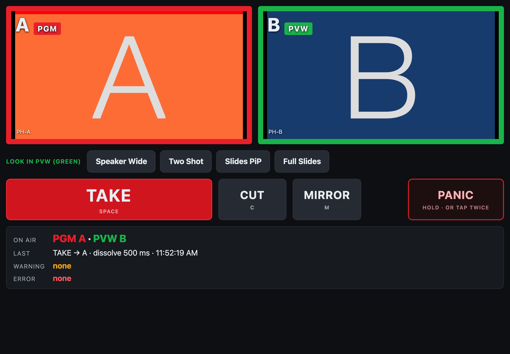

# abswitch — A/B composition switcher for mimoLive 7

> **Status: v0.1.1, a working proof, not a product.** Tested on mimoLive 7.0b3 (build 30982) with NDI test sources on one Mac.
> Bench tests 3, 4 and 7 (real cameras, real audio, glass-to-glass latency) have not been run yet.
> MIT licensed (`LICENSE`; mimoLive's own layer files inside `documents/*.tvshow` are Boinx's, see Files). Every claim is backed by a test in `test/`, and `test/falsify/` shows each check failing where it should.

Two mimoLive documents compose independently and alternate PGM/PVW roles. A third
document owns the only on-air output and performs the TAKE with its Video Switcher
layer. `takectl` is the brain: it knows which document is on air, fires the
transition, verifies it against the switcher's own live slot, lights tally in A and B,
and gives Companion/Stream Deck one button to press.

```
   cameras / Keynote / MyLowerThird  (NDI, shared)
              │              │
        ┌─────▼─────┐  ┌─────▼─────┐
        │  PH-A     │  │  PH-B     │   composition documents
        │  layers   │  │  layers   │   (video-only NDI out, TALLY layer on top)
        └─────┬─────┘  └─────┬─────┘
          NDI "PH-A"     NDI "PH-B"
              │              │
        ┌─────▼──────────────▼─────┐
        │  PH-MASTER               │   Video Switcher: slot1=PH-A slot2=PH-B
        │  audio from interface    │   program audio lives HERE only
        │  record / stream / NDI   │
        └─────────────▲────────────┘
                      │ HTTP API :8989  (signals, tally, datastore, websocket)
                ┌─────┴─────┐
                │  takectl  │ :8991   /take /cut /mirror /panic /state
                └─────▲─────┘
                      │ HTTP
               Companion / Stream Deck
```

Everything takectl does is in the public mimoLive 7.0b3 HTTP API
(https://mimolive.com/user-manual/remote-control-automation/http-api/endpoints/):

| takectl action | mimoLive API used |
|---|---|
| discover docs/layers/sources | `GET /documents`, `/layers`, `/sources`, `/output-destinations` |
| TAKE / CUT | `GET /documents/{M}/layers/{switcher}/signals/tvGroup_Control__Dis_n_TypeSignal` (or `Cut_n`) |
| who is on air (ground truth) | `GET /documents/{M}/layers/{switcher}` → `input-values.tvGroup_Hidden_Inputs__currentLiveSource` (+ per-slot codes in `output-values`) |
| cross-check only (witness) | `GET /documents/{M}/sources/{ndiA}` → `attributes.tally-state` |
| tally lights in A/B | `GET /documents/{A}/layers/{TALLY}/setLive` / `setOff` |
| persist role state | `PUT /documents/{M}/datastores/abswitch-state` |
| mirror PGM look into PVW | `GET /documents/{PVW}/layer-sets/{id}/recall` |
| catch changes made outside takectl | `ws://host:8989/api/v1/socket` → `sources changed` |

## Build the three documents

**Design rule: where a layer lives.**
- Anything that must survive a TAKE goes in **PH-MASTER, above the switcher**: the bug, a clock,
  a persistent lower-third. That is downstream keying: it sits on top of whichever composition is
  on air and never dissolves.
- Anything that belongs to a scene goes in **PH-A and PH-B**: cameras, slides, PiPs, scene graphics.

**PH-A.tvshow and PH-B.tvshow** (identical; build one, Save As the other)
1. Show Settings: same size and frame rate as MASTER (1920×1080, 30 or 60 — pick one and match everywhere).
2. Add your NDI cameras, Keynote NDI, MyLowerThird browser source, etc.
3. Build the layer stack you want to switch between. Create Layer Sets for your standard looks
   (e.g. `Speaker Wide`, `Two Shot`, `Slides PiP`, `Full Slides`). **Use identical Layer Set names in A and B** — `/mirror` relies on that.
4. Top of the stack: a Box/Placer layer named exactly `TALLY` — a 24-px red border frame, or a solid red bar across the top,
   whatever you can see from across the room. Leave it **off**. takectl turns it on when that document is PGM.
   You will crop it out in MASTER (step 4 below), so the audience never sees it.
5. Output Destinations: add **NDI Output**, name it `PH-A` (`PH-B`), **Audio: none / muted**, Start with show ✓.
   Remove or disable every other output destination.
6. Do not put program audio in these documents. If a camera source carries audio, mute it in the layer.
7. Enable Settings → Remote Control → Allow Remote Control Access (no password, or set `apiPasswordSha256`).

**PH-MASTER.tvshow**
1. Same size/frame rate.
2. Sources: NDI `PH-A`, NDI `PH-B` (name them `NDI PH-A`, `NDI PH-B` to match the config), and the **audio interface** as an Audio Device source.
3. Layer stack, bottom to top:
   - **Video Switcher**, name it `AB Switcher`. Source Count = 2. Slot 1 = NDI PH-A, Slot 2 = NDI PH-B. Transition Duration = 0.5 s.
     Disable audio-follow-video on this layer (the switcher must not carry audio).
     If you kept a TALLY frame in A/B, set the switcher's geometry to zoom ~2.5 % so the frame is cropped off.
   - **Audio Only** layer fed by the audio interface — this is program audio.
   - Persistent graphics (bug, clock, anything that must survive a TAKE) go here, **above** AB Switcher.
   - Optional: a `MASTER TALLY` text layer that shows "A" / "B" (takectl can be extended to set its text).
4. Output Destinations: File Recording, Live Streaming, and/or NDI `PH-PGM` to the streaming Mac. Start with show ✓.
5. Right-click the switcher's "Cut 1" button → *Copy URL to Trigger Button*. Paste it in a browser.
   If it switches, the API is alive and takectl will find the same signal key automatically.

## Run

```
cp takectl.config.example.json takectl.config.json   # edit hosts / names
node takectl.mjs doctor      # discovery + preflight, exits non-zero on problems
node takectl.mjs             # runs the controller on :8991
```

`doctor` prints the signal keys it found. If `dis` is empty, your beta's Video Switcher uses
different input keys — copy the URL from the right-click menu and set the key names in the config
(open an issue; the regex in `Master.discover()` is the only place to touch).

Endpoints (all GET, all return JSON):

| | |
|---|---|
| `/` | the operator page (HTML; see "Operator page" below) |
| `/take` | dissolve PVW → PGM, flip roles. Refused if busy or preflight fails. |
| `/cut` | same, hard cut |
| `/mirror` | recall PVW's Layer Set with the same name as PGM's active set (start the next look from the current one) |
| `/pvw/layer-set/<name>` | recall the Layer Set `<name>` in whichever document is PVW (green) now. Refused if PVW has no set of that name, while a transition is busy or in flight, or if the switcher says PVW is on air |
| `/panic` | cut to A, then read the switcher and cut again while it is not on A (at most 3 rounds). Wins over a TAKE in progress. Answers once A is confirmed |
| `/resync` | re-read the switcher's live slot and re-apply roles |
| `/state` | pgm, pvw, busy, switcher slot + per-slot codes + `inFlight`, source tally, `warning`, last take, last error, Layer Set names, document ids, recent events |

Preflight before every transition checks:
- the target document is live;
- its NDI output is live;
- MASTER has a signal for its slot;
- no layer named `COUNTER` is live in A or B. That layer is the bench stopwatch and would go to air.

A failed preflight returns `ok:false` with the reason and does **not** touch MASTER. `doctor` runs the
same checks. `"preflight": false` in the config disables all of them, the COUNTER check included.

**TALLY during a transition:**
- The incoming document's TALLY lights as soon as the TAKE is sent.
- The outgoing document's TALLY stays lit until the switcher read-back confirms the new PGM, which
  is dissolve + settle, ~750 ms. So both are lit through the dissolve.
- Startup, resync and `/panic` set both at once.
- If a transition stays in flight for more than 5 s (a stuck dissolve, a frozen source), `/state.warning`
  reads `transition stalled (… ms)`. takectl decides nothing; the next settled read clears it.
- takectl reads each TALLY layer back 800 ms after setting it. On 7.0b3 a layer switched off within
  ~15 ms of being switched on can stay in `shutdown`, and then ignores `setLive`; takectl repairs it.

## Operator page

Open `http://<takectl-host>:8991/` on an iPad (or any browser) on the show network. It is one
self-contained file, `operator.html`, served by takectl: no build step, no CDN, no internet needed.



- **Tiles:** each document's program output, live (`programOut` as MJPEG, 10 fps, 960 wide).
  - Border red = PGM, green = PVW.
  - **Both red** while a transition is busy or in flight.
  - Grey with "takectl unreachable" if `/state` has not answered for 2 s.
- **Look in PVW (green):** one button per Layer Set present in both A and B. Each calls
  `/pvw/layer-set/<name>`, so it can only ever change the green document.
- **TAKE** (Space), **CUT** (C), **MIRROR** (M), all disabled while a transition is busy or in flight.
- **PANIC** (far right): hold 0.7 s, or tap twice within 1 s. One tap only arms it ("TAP AGAIN").
  There is deliberately no key for it.
- **Status:** PGM/PVW, the last TAKE/CUT with its transition and duration, `warning`, `lastError`.
  A refused TAKE (preflight, busy) shows the server's reason in a large toast for 6 s; tap to dismiss.

**Pictures across origins.** The page comes from takectl (:8991); the pictures come straight from
each document's mimoLive (:8989, or another host). That is fine for ``: no CORS involved.
- A document host of `localhost` in the config is rewritten to the address the page was opened
  from, so an iPad gets the Mac's address instead of its own.
- With `apiPasswordSha256` set, the pictures will not load: `` cannot send the password header.

## Companion page

Use the **Generic HTTP** module pointed at `http://<takectl-host>:8991`, plus Companion's HTTP API
(Settings → HTTP → enable) so takectl can push custom variables `ab_pgm`, `ab_pvw`, `ab_error`.

| Key | Action | Feedback |
|---|---|---|
| **TAKE** (big, red) | GET `/take` | text `$(custom:ab_pvw) → PGM`; flash while `/state.busy` |
| CUT | GET `/cut` | |
| MIRROR | GET `/mirror` | |
| A | none (label only) | background red if `$(custom:ab_pgm) == A`, green if `== B` |
| B | none | inverse |
| PANIC | GET `/panic` | hold-to-press |
| ERR | none | text `$(custom:ab_error)`, red when non-empty |

Operator rule printed on the deck: **compose only in the GREEN document.**
Rest of the deck: Layer Set recall buttons that target *both* A and B
(Companion mimoLive module, one connection per document) — the one that's PGM gets ignored
by convention; or better, route them through takectl so they only hit PVW: GET `/pvw/layer-set/<name>`.

## Why this shape and not the alternatives

- **Not the Automation Layer.** It runs inside a document, has no cross-document state, and its
  timing is explicitly not real-time. takectl holds state in one place and uses the switcher's own
  live slot as ground truth, so an operator clicking in MASTER directly can't desync it.
- **Not Multi-Out.** Program outputs in 7.0 share layer live-state, variants and Layer Sets; only
  parameter values can differ. That's one composition at two sizes, not two compositions.
- **Truth, wake, witness.** Who is on air comes from the Video Switcher itself: its live slot
  (`currentLiveSource`), read after every TAKE at dissolve + settle and on every wake-up. The
  switcher sends no event when it switches, but both NDI sources do (`sources changed`, at every
  cut and at both ends of every dissolve), so those events and a 5 s poll are the wake-up, never
  the fact. Both slots reading code 30 means a transition is in flight, and such a read decides
  nothing anywhere (resync, verify, panic, doctor): come back.
  The sources' `tally-state` is only a witness. If it disagrees with the switcher for more than one
  settle period, takectl logs it once and shows `warning` in `/state`, and never moves the roles
  for it. On this beta a source's tally once stuck at `program` for over an hour while the switcher was
  right (CHANGES.md, item 9). The datastore copy is only a fallback at startup.
- **A and B stay identical, by design.** The TAKE only works if either document can carry any
  look. GPU savings come from trimming both stacks the same way and moving persistent graphics up
  to MASTER, above the switcher, never from letting the two documents differ.
- **Audio only in MASTER.** Two NDI paths with slightly different latency dissolved together comb-filter.
  A and B publish video only; the audio interface feeds MASTER directly.

## Bench protocol — do these before trusting it in a show

1. **Independence.** Hide/minimize PH-A's window behind PH-MASTER. Confirm NDI PH-A keeps updating
   in MASTER's multiview (mimoLive renders when a document is live regardless of window state; verify on this beta).
2. **Signal control.** `node takectl.mjs doctor` shows cut/dis keys for slots 1 and 2. `curl :8991/cut` twice; watch MASTER.
3. **Frame-cleanliness.** Put a frame counter into both A and B. The release ships without one; add the
   bench stopwatch back:
   - **By script:** `BENCH_COUNTER=1 node documents/build-documents.mjs` (documents open in mimoLive).
   - **By hand:** in PH-A and PH-B, a **Stopwatch** layer named exactly `COUNTER`, counting up, Start on Live,
     1/100 s, and left out of every Layer Set ("No Action"; never recorded as off).
   - takectl refuses every TAKE and CUT while COUNTER is live, so record this test with `"preflight": false`
     in a temporary config (`test/record-take.mjs` does exactly that). Delete COUNTER in both and save afterwards.

   Record MASTER. Scrub the dissolve: one source should fade to the other with no black, no freeze, and identical counter values at the
   midpoint (proves A and B latency is symmetric). If the counters differ by a frame, one NDI receiver is on a
   different bandwidth/latency setting — match them.
4. **Audio.** Play tone through the interface. TAKE ten times. Record. Spectrogram should be flat through every
   transition. Any dip/comb = audio leaked into A or B's NDI.
5. **Desync recovery.** While takectl runs, click "Dis 1" in MASTER's UI. Within ~0.5 s `/state` should show
   PGM=A and the TALLY layers should have flipped. Then kill takectl, TAKE manually, restart takectl — it must
   start with the correct PGM from the switcher, not from the stale datastore
   (scripted: `node test/bench5-check.mjs`).
6. **Load.** All three documents on one Mac, 1080p60, five NDI cams in each of A and B. Watch
   Status display → render time in each document. If MASTER drops frames, move A and B to the AV Mac
   (change `host` in the config; takectl doesn't care where documents live).
7. **Latency budget.** Camera → A → NDI → MASTER → NDI → streaming Mac is three NDI hops (~2–3 frames each).
   Measure glass-to-glass with a clapper. Fine for stream; if there's room video from MASTER, know the number.

## Before a live show

1. **No `COUNTER` layer in PH-A or PH-B.** The package ships without it. If you added it back for bench
   test 3, delete it in both and save: it goes to air, no Layer Set switches it off, takectl refuses every
   TAKE and CUT while it is live, and `pack.sh`'s saved-files check refuses a package that has one.
2. **`node takectl.mjs doctor` exits 0.**
3. **MASTER crops the TALLY bar.** `NDI PH-A` and `NDI PH-B` each carry Scale & Transform at Custom,
   1920 × 1080, Zoom 105 (see `documents/README.md`). Both TALLYs are lit through every dissolve, so
   the crop is what keeps them off air.
4. **One real TAKE, recorded and scrubbed:** no TALLY edge and no black or freeze through the fade.
5. **The operator page works from the operator's device:** open `http://<takectl-host>:8991/`,
   both pictures move, the green border is on PVW.
6. **No witness warning, both ways.** With A on air and again with B on air, `curl :8991/resync`
   must show `"warning": null`. takectl no longer trusts source tally, but a warning means
   mimoLive's own tally is wrong (CHANGES.md, item 9): capture the log line for Boinx. Re-check
   after any edit to MASTER's sources.

## Files

- `takectl.mjs` — the controller (zero dependencies, Node 22+)
- `LICENSE` — MIT. It covers this project's own files. The saved documents in `documents/*.tvshow`
  also contain mimoLive's layer compositions (`Layers/*.qtz`), which mimoLive copies into every saved
  document: those belong to Boinx Software and are not covered by this license.
- `operator.html` — the operator page takectl serves at `/` (keep it next to `takectl.mjs`)
- `operator-page.png` — the screenshot above
- `takectl.config.example.json` — copy to `takectl.config.json`
- `test/mock-mimolive.mjs` — fake mimoLive 7 API + WebSocket for working offline. Its Video Switcher
  follows 7.0b3 (live slot, per-slot codes, in-flight window, cut overridden mid-dissolve); its
  source tally values are still the old ones (CHANGES.md, proposal 3). `node test/mock-smoke.mjs`
  runs takectl against it. Evidence about mimoLive comes from the real app, not the mock.
- `test/*-check.mjs` — bench checks against the real mimoLive; each writes its evidence to `test/`
  (see `test/BENCH-RESULTS.md`)
