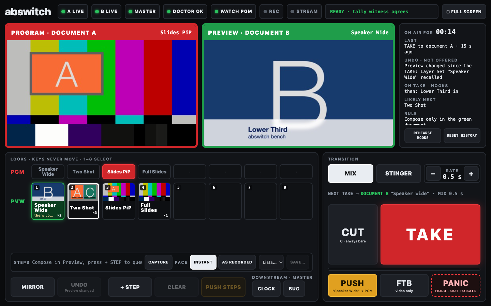
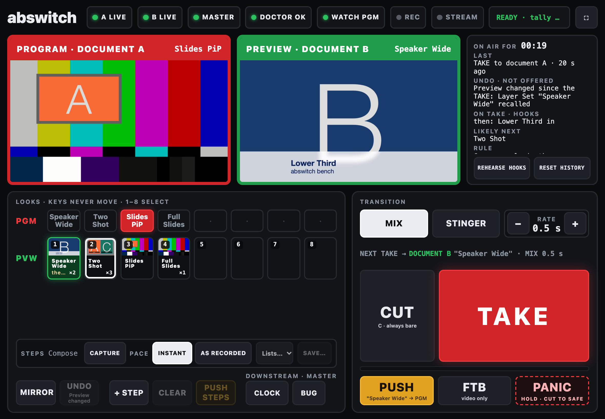
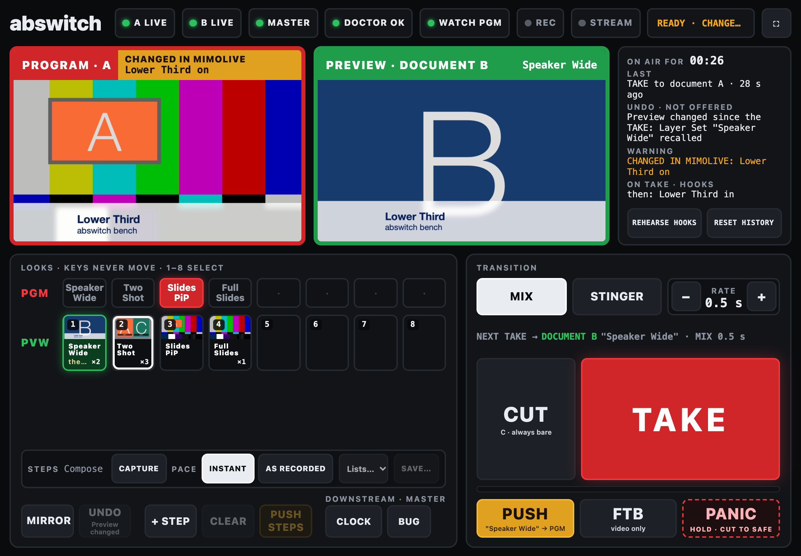

# abswitch — A/B composition switcher for mimoLive 7

> **Status: v0.2.0, a working proof, not a product.** Tested on mimoLive 7.0b3 (build 30982) with NDI test sources on one Mac.
> Bench tests 3, 4 and 7 (real cameras, real audio, glass-to-glass latency) have not been run yet.
> The source-tally item (9 in CHANGES.md: a source's tally stuck at `program` on 7.0b3) is open.
> PUSH, steps and history are a forum user's ideas.
> MIT licensed (`LICENSE`; mimoLive's own layer files inside `documents/*.tvshow` are Boinx's, see Files). Every claim is backed by a test in `test/`, and `test/falsify/` shows each check failing where it should.

Two mimoLive documents compose independently and alternate PGM/PVW roles. A third
document owns the only on-air output and performs the TAKE with its Video Switcher
layer. `takectl` is the brain: it knows which document is on air, fires the
transition, verifies it against the switcher's own live slot, lights tally in A and B,
and gives Companion/Stream Deck one button to press.

```
   cameras / Keynote / MyLowerThird  (NDI, shared)
              │              │
        ┌─────▼─────┐  ┌─────▼─────┐
        │  PH-A     │  │  PH-B     │   composition documents
        │  layers   │  │  layers   │   (video-only NDI out, TALLY layer on top)
        └─────┬─────┘  └─────┬─────┘
          NDI "PH-A"     NDI "PH-B"
              │              │
        ┌─────▼──────────────▼─────┐
        │  PH-MASTER               │   Video Switcher: slot1=PH-A slot2=PH-B
        │  audio from interface    │   program audio lives HERE only
        │  record / stream / NDI   │
        └─────────────▲────────────┘
                      │ HTTP API :8989  (signals, tally, datastore, websocket)
                ┌─────┴─────┐
                │  takectl  │ :8991   /take /push /cut /undo /mirror /panic /state
                └─────▲─────┘
                      │ HTTP
               Companion / Stream Deck
```

Everything takectl does is in the public mimoLive 7.0b3 HTTP API
(https://mimolive.com/user-manual/remote-control-automation/http-api/endpoints/):

| takectl action | mimoLive API used |
|---|---|
| discover docs/layers/sources | `GET /documents`, `/layers`, `/sources`, `/output-destinations` |
| TAKE / CUT | `GET /documents/{M}/layers/{switcher}/signals/tvGroup_Control__Dis_n_TypeSignal` (or `Cut_n`) |
| who is on air (ground truth) | `GET /documents/{M}/layers/{switcher}` → `input-values.tvGroup_Hidden_Inputs__currentLiveSource` (+ per-slot codes in `output-values`) |
| cross-check only (witness) | `GET /documents/{M}/sources/{ndiA}` → `attributes.tally-state` |
| tally lights in A/B | `GET /documents/{A}/layers/{TALLY}/setLive` / `setOff` |
| persist role state | `PUT /documents/{M}/datastores/abswitch-state` |
| mirror PGM look into PVW | `GET /documents/{PVW}/layer-sets/{id}/recall` |
| PUSH a look onto Program; steps | `GET /documents/{PGM}/layer-sets/{id}/recall` |
| stinger; hooks | `GET /documents/{M}/layers/{STINGER}/setLive` / `setOff`; hooks switch layers or recall sets the same way |
| history, steps lists, hooks | `PUT /documents/{M}/datastores/abswitch-history` / `abswitch-steps` / `abswitch-hooks` |
| catch changes made outside takectl | `ws://host:8989/api/v1/socket` → `sources changed` |

## Build the three documents

**Design rule: where a layer lives.**
- Anything that must survive a TAKE goes in **PH-MASTER, above the switcher**: the bug, a clock,
  a persistent lower-third. That is downstream keying: it sits on top of whichever composition is
  on air and never dissolves.
- Anything that belongs to a scene goes in **PH-A and PH-B**: cameras, slides, PiPs, scene graphics.

**PH-A.tvshow and PH-B.tvshow** (identical; build one, Save As the other)
1. Show Settings: same size and frame rate as MASTER (1920×1080, 30 or 60 — pick one and match everywhere).
2. Add your NDI cameras, Keynote NDI, MyLowerThird browser source, etc.
3. Build the layer stack you want to switch between. Create Layer Sets for your standard looks
   (e.g. `Speaker Wide`, `Two Shot`, `Slides PiP`, `Full Slides`). **Use identical Layer Set names in A and B** — `/mirror` relies on that.
   Leave TALLY out of every Layer Set ("No Action", never recorded as Off), or a recall fights takectl over tally.
4. Top of the stack: a Box/Placer layer named exactly `TALLY` — a 24-px red border frame, or a solid red bar across the top,
   whatever you can see from across the room. Leave it **off**. takectl turns it on when that document is PGM.
   You will crop it out in MASTER (step 3 below), so the audience never sees it.
5. Output Destinations: add **NDI Output**, name it `PH-A` (`PH-B`), **Audio: none / muted**, Start with show ✓.
   On 7.0b3 the NDI sender drops the hyphens: `PH-A` advertises as `(PHA)`.
   Remove or disable every other output destination.
6. Do not put program audio in these documents. If a camera source carries audio, mute it in the layer.
7. Enable Settings → Remote Control → Allow Remote Control Access (no password, or set `apiPasswordSha256`).

**PH-MASTER.tvshow**
1. Same size/frame rate.
2. Sources: NDI `PH-A`, NDI `PH-B` (name them `NDI PH-A`, `NDI PH-B` to match the config), and the **audio interface** as an Audio Device source.
3. Layer stack, bottom to top:
   - **Video Switcher**, name it `AB Switcher`. Source Count = 4 (7.0b3 offers only 4 or 9). Slot 1 = NDI PH-A,
     Slot 2 = NDI PH-B. Transition Duration = 0.5 s (7.0b3 caps a dissolve at 5 s).
     The switcher has no audio path on 7.0b3, so there is no audio-follow-video to disable.
   - **Crop the TALLY bar** on the two sources, not the switcher (it has no zoom): give `NDI PH-A` and `NDI PH-B`
     each a **Scale & Transform** filter at Mode Custom, 1920 × 1080, Zoom 105. That takes about 27 px off the top
     and bottom and 48 px off each side. A 2.5 % zoom takes only ~13 px and does not hide a 24 px bar.
   - **Audio Only** layer fed by the audio interface — this is program audio.
   - Persistent graphics (bug, clock, anything that must survive a TAKE) go here, **above** AB Switcher.
   - Optional: a `MASTER TALLY` text layer that shows "A" / "B" (takectl can be extended to set its text).
4. Output Destinations: File Recording, Live Streaming, and/or NDI `PH-PGM` to the streaming Mac. Start with show ✓.
5. Right-click the switcher's "Cut 1" button → *Copy URL to Trigger Button*. Paste it in a browser.
   If it switches, the API is alive and takectl will find the same signal key automatically.

## Run

**Double-click `start.command`.** It checks for Node.js 22 or later and says what to install if it
is missing, starts takectl and opens the operator page. The first time, macOS may refuse a file
downloaded from the internet: right-click `start.command`, choose Open, then Open again.

**First run: setup.** With no `takectl.config.json`, takectl starts in setup mode and the page
opens at `/setup`.
1. Choose the three documents from dropdowns. They can be on one Mac or on three: each has its own
   "mimoLive at" address.
2. Choose the two NDI sources and the switcher layer in MASTER. When the names match (PH-A,
   NDI PH-A, AB Switcher …) they are chosen for you.
3. Choose the **safe source** PANIC cuts to (optional; see "Safe source" below). A source sitting in
   a switcher slot of its own is chosen for you; "None" keeps PANIC on A.
4. Save writes the config and takectl starts running.

Anyone on the network can look at `/setup`, but Save and Start Over work only from the Mac running
takectl. Once set up, `/setup` shows the saved choices, and **Start Over** (on that Mac, with the
master's show stopped) keeps the old config as a dated backup and opens setup again.

**Doctor.** `/doctor` shows every check as a green or red light, each red one with a one-sentence
fix. The operator page's status strip turns red and links there when any check fails. The same
list from a terminal: `node takectl.mjs doctor`, which exits 1 when anything is red. If mimoLive or
a document is not open yet, or goes away later, takectl keeps its pages up and tries again every
3 s, then reads who is on air from the switcher. PANIC keeps working meanwhile as long as the master
document can be reached. Layer Set names that exist in only one document are a warning, not a
failure: their buttons stay greyed.

By hand, without the launcher:
```
cp takectl.config.example.json takectl.config.json   # edit hosts / names (or use /setup)
node takectl.mjs doctor      # the checklist; exits non-zero on problems
node takectl.mjs             # runs the controller on :8991
```

`doctor` prints the signal keys it found. If `dis` is empty, your beta's Video Switcher uses
different input keys — copy the URL from the right-click menu and set the key names in the config
(open an issue; the regex in `Master.discover()` is the only place to touch).

Endpoints (all GET, all return JSON):

| | |
|---|---|
| `/` | the operator page (HTML; see "Operator page" below). Before setup it sends you to `/setup` |
| `/setup` | choose the documents, sources and switcher; Save writes the config (only while there is none) |
| `/doctor` | the checklist as green and red lights with fixes; `/doctor.json` is the same as data |
| `/take` | dissolve PVW → PGM, flip roles. Refused if busy or preflight fails. |
| `/cut` | same, as a bare cut: never the stinger (as on an ATEM); its hooks still run |
| `/mirror` | recall PVW's Layer Set with the same name as PGM's active set (start the next look from the current one) |
| `/pvw/layer-set/<name>` | recall the Layer Set `<name>` in whichever document is PVW (green) now. Refused if PVW has no set of that name, while a transition is busy or in flight, or if the switcher says PVW is on air |
| `/push` | recall PVW's active Layer Set on PGM, live (the look changes on air; the documents keep their roles). Refused while busy or in flight, when PVW has no active set, or when PGM has no set of that name |
| `/undo` | take back to the previous look. Only after a TAKE or CUT, and only while nothing has been sent to PVW since (`/state.undo.why` says why not) |
| `/steps/add`, `/steps/clear`, `/steps/record?on=1\|0` | build a list of looks: add PVW's active set, clear, or record every PVW recall as a step |
| `/steps/push?pace=instant\|original` | push the steps onto PGM in order: each as soon as the last has landed, or at the recorded pace (gaps capped at 10 s). With the stinger on, an instant run goes under **one** stinger (only the last step's post-hooks run, after the reveal); at the recorded pace the stinger covers the first step only |
| `/steps/save?name=`, `/steps/load?name=`, `/steps/delete?name=`, `/steps` | named lists, kept in MASTER |
| `/history`, `/history/reset?confirm=1` | which looks followed which (the page shows it as emphasis) |
| `/stinger?on=1\|0` | cover TAKE, CUT, PUSH and steps with MASTER's STINGER layer (see "Stinger and hooks") |
| `/transition?mode=mix\|stinger`, `/rate?s=` | the transition selector; the switcher's dissolve length (0.1–5 s) |
| `/ftb?on=1\|0`, `/dsk?label=<label>&on=1\|0` | fade to black (video only) and the downstream keys. Not commits: they work mid-transition and in SAFE, and are not logged |
| `/pvw/layer-set?name=`, `/thumb?name=` | the query forms of the look routes (any name, including "." and ".."); `/thumb` serves a look's still |
| `/hooks`, `/hooks/rehearse` | the hooks in use; run the post-hooks of a take to PVW's look, in PVW. `POST /hooks` (from the takectl Mac only) saves hooks in MASTER |
| `/panic` | cut to the safe source (or to A when none is set up), then read the switcher and cut again while it is not there (at most 3 rounds). Wins over a TAKE in progress. Cancels pending hooks and steps and switches the stinger off; leaves FTB as it is. Answers once the switcher confirms; with the safe source already on air it answers at once, without a cut |
| `/safe/target?doc=A\|B` | while SAFE (or another slot) is on air: which document a TAKE or CUT goes to. It is Preview: `/state.pvw` names it |
| `/watch?on=1\|0`, `/watch/dismiss` | WATCH PGM on or off (runtime only); accept a change made in mimoLive's window to Program (see "Working live"). `/watch` alone is the watch state, also in `/state.watch` |
| `/resync` | re-read the switcher's live slot and re-apply roles |
| `/state` | pgm, pvw, busy, switcher slot + per-slot codes + `inFlight`, source tally, `warning`, last take, last error, Layer Set names, document ids, recent events |

Preflight before every transition checks:
- the target document is live;
- its NDI output is live;
- MASTER has a signal for its slot;
- no layer named `COUNTER` is live in A or B. That layer is the bench stopwatch and would go to air.

A failed preflight returns `ok:false` with the reason and does **not** touch MASTER. `doctor` runs the
same checks. `"preflight": false` in the config disables all of them, the COUNTER check included.

### Safe source

PANIC needs somewhere to go that is always fine to show. With a **safe source** set up, PANIC cuts
the master's switcher to it instead of to document A.

- **What to use:** a wide camera wired straight into the master document, or a holding slide with
  your branding, in a switcher slot of its own (slot 3 on the bench). **Never a test pattern for a
  show**: colour bars on air look like a fault. `documents/build-documents.mjs` puts a "SAFE Test
  Pattern" (mimoLive's Video Output Test source, Philips PM5544) in slot 3. It is a **bench** slate
  only.
- **Setup** offers every source in the master document. Without one, PANIC cuts to A, whatever A
  shows, and the doctor says so.
- **While SAFE is on air** (`/state.pgm` is `"SAFE"`):
  - both TALLYs are off and both documents are free to compose in;
  - TAKE and CUT go to the document that was Preview when PANIC was pressed. A selector on the
    operator page (or `/safe/target?doc=A|B`) changes it, and that document is shown as Preview;
  - PUSH, steps, UNDO and MIRROR are refused. Layer Set buttons recall into the TAKE target;
  - a TAKE out of SAFE runs MASTER pre-hooks only, then post-hooks as usual, and cannot be undone.
- **Selected in mimoLive by hand:** the safe source's slot puts takectl into SAFE. Any other slot
  (an empty slot reads as slot 9) puts it into `"OTHER"`, with a warning naming the slot. Commands
  behave as in SAFE, and PANIC still goes to the safe source (or A).
- **History** logs panics and takes out of SAFE, marked; they never count towards which look
  usually follows which.

### Downstream keys and fade to black

**Downstream keys:** every layer in MASTER named **`DSK <label>`** that sits above the AB Switcher
becomes a toggle labelled `<label>`.
- They stay as set across every TAKE, CUT and PUSH.
- They work mid-transition and in SAFE, PANIC leaves them alone, and they are not logged in history.
- The bench has two, both off: `DSK Bug` (mimoLive's Station Logo layer, top right) and `DSK Clock`
  (Date and Time, top left).
- They sit above the stinger, as an ATEM's keys sit above its transitions, so a bug stays up
  through a wipe. Measure a new stinger with them off.
- A `DSK` layer below the switcher would be covered by it, so it is not a toggle; the doctor warns.

**FTB:** MASTER's `FTB` layer, at the very top, fades program to black in 0.5 s and back.
- **Video only: program audio is not touched.** FTB is a picture layer over the separate Program
  Audio layer, so the sound carries on.
- TAKE, CUT and PUSH still work underneath it, and PANIC leaves it as it is.

### Stinger and hooks

**Stinger.** `documents/build-documents.mjs` gives MASTER a `STINGER` layer above the switcher: the
**default stinger**, a slate box that wipes in from the left and out to the right in 0.4 s.
- It is a plain mimoLive layer with built-in animations: no video file, nothing to install, and it
  works in any document the build script makes.
- Its cover window is measured, and the config defaults (`stingerCoverMs` 500, `stingerOffMs` 120)
  are those measurements.

With the stinger on (`"stinger": true` in the config, or the
page's STINGER key), every TAKE, PUSH and step (never a CUT, which is always bare):
1. sets STINGER live;
2. waits `stingerCoverMs` (500: the wipe is fully closed by ~420 ms);
3. cuts underneath;
4. switches STINGER off `stingerOffMs` (120) later.

**Your own stinger media:** put it on the `STINGER` layer (or a layer named in `stingerLayerName`),
then run `node test/stinger-cover.mjs --write`. It measures the cover window on MASTER's program
output and sets both values; the defaults fit only the slate wipe. Run it again after any change of
media or of network (documents on other Macs add delay to every command). The default leaves the
cut about 84 ms inside full cover, which is thin across Macs.

A missing STINGER layer means the TAKE goes ahead without it, with a warning. A
STINGER already live, or stuck in `shutdown`, refuses the TAKE: PANIC switches it off.

**Hooks** fire extra actions around a TAKE, CUT, PUSH or step (never on their own):
- `pre`: on the outgoing Program document, before the signal, then wait `waitMs`.
- `post`: on the new Program document, once the switcher confirms (or the stinger has cleared),
  each after its own `delayMs`.

Key them by the Layer Set you take **to**, or by a pair `"From -> To"`, which wins:

```json
"hooks": {
  "Interview":            { "post": [ { "layer": "Lower Third", "set": "live", "delayMs": 300 } ] },
  "Interview -> Slides":  { "pre":  [ { "layer": "Lower Third", "set": "off" } ], "waitMs": 400 },
  "Wide":                 { "post": [ { "layerSet": "Wide Cams" }, { "layer": "Applause", "set": "live", "in": "master" } ] }
}
```

- An action switches a layer (`"set": "live"` or `"off"`) or recalls a Layer Set, in the Program
  document or, with `"in": "master"`, in MASTER. An Automation layer is a layer: set it live.
- Hooks live in the config, or in MASTER's `abswitch-hooks` datastore via `POST /hooks` with the same
  JSON from the takectl Mac. The datastore wins, name by name.
- A failing hook shows in the Warning line; the take stands.
- PANIC cancels hooks that have not run.
- The look buttons show what a take to them will do ("then: Lower Third in"). REHEARSE HOOKS runs
  those post-hooks in the green document, so you can see them before air. MASTER actions are
  skipped. Two seconds after the last one, every layer they touched is put back as it was, so the
  next TAKE still brings them in on air. Until then TAKE, PUSH and the other commands wait.
- **Keep hook layers out of Layer Sets.** A lower third that a hook brings in must be "No Action" in
  every set, or a recall will take it out again. The bench documents have one: `Lower Third`.

**TALLY during a transition:**
- The incoming document's TALLY lights as soon as the TAKE is sent.
- The outgoing document's TALLY stays lit until the switcher read-back confirms the new PGM, which
  is dissolve + settle, ~750 ms. So both are lit through the dissolve.
- Startup, resync and `/panic` set both at once.
- If a transition stays in flight for more than 5 s (a stuck dissolve, a frozen source), `/state.warning`
  reads `transition stalled (… ms)`. takectl decides nothing; the next settled read clears it.
- takectl reads each TALLY layer back 800 ms after setting it. On 7.0b3 a layer switched off within
  ~15 ms of being switched on can stay in `shutdown`, and then ignores `setLive`; takectl repairs it.

## Operator panel

Open `http://<takectl-host>:8991/` on an iPad in landscape, or any browser, on the show network. It
is one self-contained file, `operator.html`, served by takectl: no build step, no CDN, no internet
needed. It fits one screen with no scrolling at 1440×900 and on an iPad in landscape, and every
control is a real button of at least 44 px. **Keys never move**: nothing on the panel changes
place when the state changes.





- **Header:** lamps for A live, B live, MASTER and the doctor (each opens `/doctor`). **WATCH PGM**
  (see [Working live](#working-live)). **REC** and **STREAM** light when MASTER's File Recording or Live
  Streaming output is running. They are display only, and hidden when MASTER has no such output. A
  one-line status reads ready, in transition, fade to black, or SAFE ON AIR. **⛶** goes full screen.
- **Monitors:** Program on the left in red, Preview on the right in green. They never swap sides;
  only the document letter in the header changes, and each header shows that document's look. Each
  picture is exactly 16:9, with no bars beside it: on a wide, short screen the monitors are no wider than
  their pictures, and the readout takes the width left over.
  - Program shows MASTER's program out, so downstream keys, the stinger and FTB show on it.
  - Mid-transition both frames are red and Preview reads IN TRANSITION.
  - **CHANGED IN MIMOLIVE** or **NOT WATCHED** can take over Program's header strip (amber, never over the
    picture): see [Working live](#working-live).
  - **STALE:** the pictures are stills fetched one after another, about 10 a second, so the page
    knows when each frame arrived. A monitor with no new frame for 1 s, or whose document's show is
    not running, is dimmed and marked STALE until frames come back. mimoLive keeps serving the last
    frame of a stopped show, so the show's state is checked too.
- **Look keys:** two rows of the same 8 keys in the same order, built from the Layer Sets.
  - **PGM** is lamps only: the look on air is lit red.
  - **PVW** keys recall that look in Preview, the green document, and the selected one is lit green.
    Keys **1–8** do the same.
  - Each PVW key is the shape of the picture: a still of its look on top, whole (fitted, never
    cropped), and the look's name in a band of its own underneath, never over the picture. The slot
    number sits on the picture's top-left corner. The still is taken about 1 s after takectl recalls the
    look in Preview, and kept on disk beside the config. Only the slot number sits on the picture.
  - The band also shows the hooks a TAKE to that look would run. A **white ring** marks the look that most
    often follows Program's current one (every one, on a tie; only once that look has been left 3 times).
    The band shows how often it followed (**×3**, right-aligned on its bottom line), and the word **NEXT**
    beside the name when it fits there whole; when it doesn't, the ring alone marks it.
  - An empty slot is a key of the same size, unlit.
  - A name only one document has stays in its place, greyed, labelled "only in A" / "only in B".
  - More than 8 Layer Sets: the first 8 (A's order) and a warning.
- **Steps strip:** the queued looks as numbered chips; **CAPTURE** (lit while every Preview recall
  becomes a step; the header's REC is MASTER's recording, a different thing); **PACE**: INSTANT or AS
  RECORDED; and saved lists.
- **Utility row:** MIRROR, UNDO, + STEP, CLEAR, PUSH STEPS, and one toggle per **downstream key**.
  When UNDO or PUSH is off, the key says why in a few words ("Preview changed"), and the readout and
  the tooltip give the whole reason.
- **Transition block:**
  - **MIX / STINGER** selector; the config's `stinger` sets which is selected at start.
  - **RATE** (−/+): the switcher's own dissolve length, 0.1–5 s, read again at every TAKE, so a change
    made in mimoLive is honoured.
  - A line saying where the **next TAKE** goes ("NEXT TAKE → DOCUMENT B "Slides PiP" · MIX 0.5 s").
    In SAFE the TAKE GOES TO selector takes its place.
  - **CUT** (always a bare cut, as on an ATEM: it never fires the stinger; its hooks still run).
  - **TAKE** with a bar under it that runs for the transition's length.
  - **PUSH** (amber), **FTB** (lit red while black), **PANIC** (dashed guard: hold 0.7 s; no key).
- **Readout:** time on the current look, the last action, why UNDO is not offered, warnings and errors
  with their age (these are never the part that gets cut), the hooks the next TAKE will run (REHEARSE
  HOOKS runs them in Preview, then puts Preview back) and the likely next look. RESET HISTORY asks for a
  second tap.
- **SAFE ON AIR / SLOT n ON AIR** (after PANIC to the safe source, or another slot chosen in mimoLive):
  - Program shows MASTER's program, and Preview shows the document the next TAKE goes to.
  - A **TAKE GOES TO** selector appears beside TAKE.
  - LAST reads "PANIC: SAFE on air. Next TAKE goes to document X".
  - MIRROR, PUSH, UNDO and PUSH STEPS show as disabled.
- **Keyboard:** Space TAKE, C CUT, P PUSH, M MIRROR, U UNDO, 1–8 a look in Preview. Nothing for PANIC.
  Keys are ignored while typing in a field.
- **View only:** `http://<takectl-host>:8991/?view=monitor` shows the monitors, header, readout and
  look lamps, with no buttons and no keyboard. Use it on a producer's or client's screen. It is a page
  without buttons, **not** access control: anyone on the network can still send takectl's routes.
- **On an iPad for a show:** set Settings → Display & Brightness → **Auto-Lock to Never**. The page
  cannot keep the screen awake over plain http, and a locked iPad drops the panel mid-show. Add the
  page to the Home Screen for full screen.

**Pictures across origins.** The page comes from takectl (:8991); the pictures come straight from
each document's mimoLive (:8989, or another host). That is fine for ``: no CORS involved.
- A document host of `localhost` in the config is rewritten to the address the page was opened
  from, so an iPad gets the Mac's address instead of its own.
- With `apiPasswordSha256` set, the pictures will not load: `` cannot send the password header.
- The monitors ask mimoLive for about 10 stills a second each (`programOut?format=jpeg`, measured at
  6–17 ms apiece on 7.0b3).

## Working live

Everything is meant to go through takectl, but mimoLive's own window is always there, and a show is
sometimes fixed in it by hand. takectl listens to mimoLive's event socket (`/api/v1/socket`, the one
mimoLive's own remote tools use) for both documents, and says when the one on air was changed there.

**Program changed in mimoLive.** If someone changes the on-air document in mimoLive's window, Program's
header strip turns amber: **CHANGED IN MIMOLIVE** and what changed ("Lower Third on", "Lower Third:
Title", "Layer Set "Wide" edited"). The readout's WARNING line says the same.



- "Changed" means a layer switched on or off, a layer's setting edited, a variant added or removed, a
  layer or a Layer Set added, removed, renamed, moved or edited.
- It never blocks a command, and it is never a reason to do anything on air by itself.
- **TAKE, CUT, UNDO or PANIC** clear it (another document goes on air). A **PUSH** does not: the same
  document stays on air, with whatever was changed in it.
- **Tap the strip** to accept the change: Program as it is now becomes what takectl expects.
- Not flagged:
  - takectl's own changes (a PUSH, steps, hooks, a rehearsal, a Preview recall), on the layers it named,
    until they have settled plus 0.5 s, 3 s at most. A change by hand to a **different** layer in that
    moment is still flagged;
  - TALLY;
  - values that move by themselves: audio levels, time remaining, a clock's time;
  - whether a Layer Set reads active: mimoLive works that out from the layers.
- **A layer a hook switches on** is not watched until it reads off again, however long that takes, so a
  lower third with a set duration can end itself.
- **`watchIgnoreLayers`** in the config, a list of layer names, is for the other layers that change on
  their own: a lower third with a set duration that a Layer Set brings in, a countdown, or anything an
  Automation Layer drives. Their changes never warn. A name that matches no layer in A or B is a
  warning.
- **WATCH PGM** in the header turns the warning off for a show where working live in Program is the
  norm. It is on at every start (runtime only). Its lamp is green while watching, red while the event
  socket is down.

**NOT WATCHED** on the strip: the event socket is down. takectl reconnects every 2 s; when it is back,
it reads both documents again and flags what changed meanwhile ("…, while not watched").

**Preview changed in mimoLive.** No warning: composing Preview by hand is normal. But UNDO goes off
("Preview changed"), since it could no longer put back what was on air, and about 1 s after Preview
settles, the thumbnail of the look it then shows is taken again.

## Known limits

- **Bench tests 3, 4 and 7** (real cameras, real audio, glass-to-glass latency) have not been run, and the
  source-tally item (9) is open: see the status line at the top.
- **The watch** (Working live) does not flag:
  - a change by hand to a layer takectl is writing, inside its settle window;
  - a change to a layer a hook switched on, before it next reads off;
  - a real edit to a layer's settings in the 600 ms after that layer switches (mimoLive blanks and
    restores its source names then, by itself).
- **A Preview composed by hand** that matches no Layer Set gets no new thumbnail.
- **One mechanism has no test of its own:** when takectl re-reads a document (a tap on the strip, or the
  socket coming back), it keeps whatever a message changed while it was reading, rather than the older
  read. The tests cannot make that race happen on cue.
- **8 look slots.** With more Layer Sets, the keys show the first 8 (in A's order) and the panel's WARNING line
  says so.

## Companion page

Use the **Generic HTTP** module pointed at `http://<takectl-host>:8991`, plus Companion's HTTP API
(Settings → HTTP → enable) so takectl can push custom variables `ab_pgm`, `ab_pvw`, `ab_error`.

| Key | Action | Feedback |
|---|---|---|
| **TAKE** (big, red) | GET `/take` | text `$(custom:ab_pvw) → PGM`; flash while `/state.busy` |
| PUSH | GET `/push` | |
| CUT | GET `/cut` | |
| UNDO | GET `/undo` | |
| MIRROR | GET `/mirror` | |
| A | none (label only) | background red if `$(custom:ab_pgm) == A`, green if `== B` (`ab_pgm` reads `SAFE`, or `OTHER`, while the safe source or another slot is on air) |
| B | none | inverse |
| PANIC | GET `/panic` | hold-to-press |
| ERR | none | text `$(custom:ab_error)`, red when non-empty |

Operator rule printed on the deck: **compose only in the GREEN document.**
Rest of the deck: Layer Set recall buttons that target *both* A and B
(Companion mimoLive module, one connection per document) — the one that's PGM gets ignored
by convention; or better, route them through takectl so they only hit PVW: GET `/pvw/layer-set/<name>`.

## Why this shape and not the alternatives

- **Not the Automation Layer.** It runs inside a document, has no cross-document state, and its
  timing is explicitly not real-time. takectl holds state in one place and uses the switcher's own
  live slot as ground truth, so an operator clicking in MASTER directly can't desync it.
- **Not Multi-Out.** Program outputs in 7.0 share layer live-state, variants and Layer Sets; only
  parameter values can differ. That's one composition at two sizes, not two compositions.
- **Truth, wake, witness.** Who is on air comes from the Video Switcher itself: its live slot
  (`currentLiveSource`), read after every TAKE at dissolve + settle and on every wake-up. The
  switcher sends no event when it switches, but both NDI sources do (`sources changed`, at every
  cut and at both ends of every dissolve), so those events and a 5 s poll are the wake-up, never
  the fact. Both slots reading code 30 means a transition is in flight, and such a read decides
  nothing anywhere (resync, verify, panic, doctor): come back.
  The sources' `tally-state` is only a witness. If it disagrees with the switcher for more than one
  settle period, takectl logs it once and shows `warning` in `/state`, and never moves the roles
  for it. On this beta a source's tally once stuck at `program` for over an hour while the switcher was
  right (CHANGES.md, item 9). The datastore copy is only a fallback at startup.
  If a mimoLive build does not expose the live slot or the per-slot codes, `doctor` shows both red
  and takectl runs on source tally instead, with a permanent warning, rather than refusing to start.
  On source tally, a transition that stays "in flight" for more than 6 s means the tally cannot be
  trusted: takectl then shows its last commanded state with a second permanent warning, and PANIC
  answers "cut to A sent, cannot confirm" instead of claiming it landed. No real 7.0b3 build lacks the
  keys, so this fallback is tested on the mock only (`test/mock-mimolive.mjs --no-slot-keys`).
- **A and B stay identical, by design.** The TAKE only works if either document can carry any
  look. GPU savings come from trimming both stacks the same way and moving persistent graphics up
  to MASTER, above the switcher, never from letting the two documents differ.
- **Audio only in MASTER.** Two NDI paths with slightly different latency dissolved together comb-filter.
  A and B publish video only; the audio interface feeds MASTER directly.

## Bench protocol — do these before trusting it in a show

1. **Independence.** Hide/minimize PH-A's window behind PH-MASTER. Confirm NDI PH-A keeps updating
   in MASTER's multiview (mimoLive renders when a document is live regardless of window state; verify on this beta).
2. **Signal control.** `node takectl.mjs doctor` shows cut/dis keys for slots 1 and 2. `curl :8991/cut` twice; watch MASTER.
3. **Frame-cleanliness.** Put a frame counter into both A and B. The release ships without one; add the
   bench stopwatch back:
   - **By script:** `BENCH_COUNTER=1 node documents/build-documents.mjs` (documents open in mimoLive).
   - **By hand:** in PH-A and PH-B, a **Stopwatch** layer named exactly `COUNTER`, counting up, Start on Live,
     1/100 s, and left out of every Layer Set ("No Action"; never recorded as off).
   - takectl refuses every TAKE and CUT while COUNTER is live, so record this test with `"preflight": false`
     in a temporary config (`test/record-take.mjs` does exactly that). Delete COUNTER in both and save afterwards.

   Record MASTER. Scrub the dissolve: one source should fade to the other with no black, no freeze, and identical counter values at the
   midpoint (proves A and B latency is symmetric). If the counters differ by a frame, one NDI receiver is on a
   different bandwidth/latency setting — match them.
4. **Audio.** Play tone through the interface. TAKE ten times. Record. Spectrogram should be flat through every
   transition. Any dip/comb = audio leaked into A or B's NDI.
5. **Desync recovery.** While takectl runs, click "Dis 1" in MASTER's UI. Within ~0.5 s `/state` should show
   PGM=A and the TALLY layers should have flipped. Then kill takectl, TAKE manually, restart takectl — it must
   start with the correct PGM from the switcher, not from the stale datastore
   (scripted: `node test/bench5-check.mjs`).
6. **Load.** All three documents on one Mac, 1080p60, five NDI cams in each of A and B. Watch
   Status display → render time in each document. If MASTER drops frames, move A and B to the AV Mac
   (change `host` in the config; takectl doesn't care where documents live).
7. **Latency budget.** Camera → A → NDI → MASTER → NDI → streaming Mac is three NDI hops (~2–3 frames each).
   Measure glass-to-glass with a clapper. Fine for stream; if there's room video from MASTER, know the number.

## Before a live show

1. **No `COUNTER` layer in PH-A or PH-B.** The package ships without it. If you added it back for bench
   test 3, delete it in both and save: it goes to air, no Layer Set switches it off, takectl refuses every
   TAKE and CUT while it is live, and `pack.sh`'s saved-files check refuses a package that has one.
2. **`node takectl.mjs doctor` exits 0.**
3. **MASTER crops the TALLY bar.** `NDI PH-A` and `NDI PH-B` each carry Scale & Transform at Custom,
   1920 × 1080, Zoom 105 (see `documents/README.md`). Both TALLYs are lit through every dissolve, so
   the crop is what keeps them off air.
4. **One real TAKE, recorded and scrubbed:** no TALLY edge and no black or freeze through the fade.
5. **The operator page works from the operator's device:** open `http://<takectl-host>:8991/`,
   both pictures move, the green border is on PVW.
6. **No witness warning, both ways.** With A on air and again with B on air, `curl :8991/resync`
   must show `"warning": null`. takectl no longer trusts source tally, but a warning means
   mimoLive's own tally is wrong (CHANGES.md, item 9): capture the log line for Boinx. Re-check
   after any edit to MASTER's sources.

## Files

- `takectl.mjs` — the controller (zero dependencies, Node 22+)
- `start.command` — double-click to check Node, start takectl and open the page (macOS)
- `setup.html`, `doctor.html` — the setup and doctor pages takectl serves (keep them next to `takectl.mjs`)
- `LICENSE` — MIT. It covers this project's own files. The saved documents in `documents/*.tvshow`
  also contain mimoLive's layer compositions (`Layers/*.qtz`), which mimoLive copies into every saved
  document: those belong to Boinx Software and are not covered by this license.
- `operator.html` — the operator panel takectl serves at `/` (keep it next to `takectl.mjs`)
- `operator-panel.png`, `operator-panel-ipad.png`, `operator-panel-changed.png` — the screenshots above
- `test/panel-chrome.mjs` — the panel in headless Chrome: one screen, 44 px targets, live pictures, keys
  never move, look keys and monitors exactly 16:9 with nothing cropped; `test/demo-run.mjs` plays the main moves in order for a screen recording
- `takectl.config.example.json` — copy to `takectl.config.json`
- `test/mock-mimolive.mjs` — fake mimoLive 7 API + WebSocket for working offline. Its Video Switcher
  and source tally follow 7.0b3 (live slot, per-slot codes, in-flight window, cut overridden
  mid-dissolve, `in-use` / `effect`). It also has a STINGER layer, layer animations, and `/mock/log`,
  which records what reached it and when. Its socket sends the layer, variant and Layer Set events
  7.0b3 sends, plus a running show's live values. `node test/mock-smoke.mjs` runs takectl against it.
- `test/round4-probe.mjs` — records mimoLive's event socket and says what changed in each message (the
  evidence behind Working live: `test/round4-probe-*.txt`)
  Evidence about mimoLive comes from the real app, not the mock.
- `test/stinger-cover.mjs` — measures the stinger's cover on MASTER's program output (`--write` sets
  the config)
- `test/*-check.mjs` — bench checks against the real mimoLive; each writes its evidence to `test/`
  (see `test/BENCH-RESULTS.md`)
